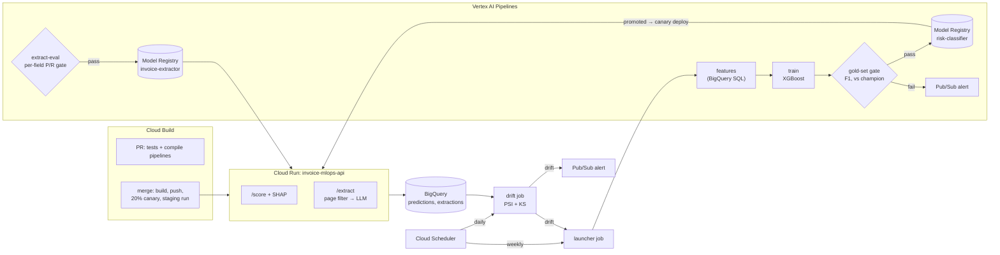

# invoice-mlops

End-to-end MLOps on Google Cloud around two engines that process invoices:

- **Engine A, risk model:** an XGBoost classifier that decides whether an invoice needs manual review. It has the full lifecycle: features in BigQuery, a Vertex AI pipeline with a gold-set gate, Model Registry, CI/CD/CT with Cloud Build, canary releases on Cloud Run with rollback, and a daily drift job that retrains it.
- **Engine B, field extraction:** an LLM reads the invoice (vendor, number, date, total, currency) with structured output, after a page filter that drops pages the LLM does not need. Each prompt version is scored per field against a gold set, and a pipeline gate rejects versions that are worse.

The point of the project is the lifecycle around the models, not the models. All data is synthetic. The infrastructure is in Terraform, and nothing uses a service-account key.

## Architecture



Read the [architecture doc](docs/architecture.md) for the flows and design decisions, and the [walkthrough](docs/walkthrough.md) for each component, why it is built that way, and what an interviewer would ask about it.

## Status

| Area | Code + tests | Ran on GCP |
|---|---|---|
| FastAPI `/score` `/health` `/version` on Cloud Run, Pandera validation, prediction log in BigQuery | ✅ | ✅ Sep–Oct 2026: 395 logged predictions |
| CI on PRs and CD on merge with Cloud Build | ✅ | ✅ every PR (green and red) since week 9 |
| Canary at 20%, rollback without rebuild, load test | ✅ | ✅ 2026-09-18 ([runbook](docs/runbook.md)) |
| KFP pipeline: train, metric gate, Pub/Sub alert on failure | ✅ | ✅ Sep 2026 (runs accepted, and `risk-train-eval-week8-fail` rejected with an alert) |
| Vertex AI Training custom jobs | ✅ | ✅ 3 hyperparameter runs, Sep 2026 |
| BigQuery features, gold-set gate vs. champion, Model Registry promotion, revisions pinned to a Registry version | ✅ | — |
| Weekly Cloud Scheduler run, daily drift job (PSI/KS) that alerts and retrains | ✅ | — |
| `/extract` (Gemini, Ollama or Gemini API), page filter, per-field precision/recall, prompt gate | ✅ | — |
| Terraform for every resource, least-privilege service accounts, SHAP | ✅ | — (`terraform plan` not run) |

"Ran on GCP" means the reference deployment in project `invoice-mlops`. What is not ticked is written and unit-tested (73 tests, with fakes for BigQuery, Pub/Sub, Vertex AI and the LLM), but has not been executed against the cloud. [Evidence log](docs/evidence.md).

## Numbers

Only measured values appear here. Values that were not measured have no number.

| What | Value | How |
|---|---|---|
| `/score` latency per revision, warm | p95 **0.32–0.66 s** (p50 0.11–0.28 s) | `hey -n 200 -c 10` during an 80/20 canary, Cloud Logging per revision, 2026-09-18 |
| Cold starts | 6 of 200 requests returned 5xx, all on the stable revision, from cold starts | same run (`min-instances=0`) |
| Risk model on the gold set (120 invoices, clean labels) | F1 **0.863**, precision 0.957, recall 0.786 | `python scripts/local_report.py` |
| Risk model on the holdout (80 invoices, 8% label noise) | F1 0.667 | same |
| Page filter on the extraction gold set | kept exactly the invoice page in **40/40** documents; 40 of 117 pages, 47% of the text, sent to the LLM | same |

Not measured: extraction precision/recall, tokens and cost per 1,000 documents, QPS, monthly cost. The code that measures each one is in the repo (`src/eval/evaluate_extract.py` reports per-field P/R, tokens, latency and cost per 1,000 docs). See [cost](docs/cost.md).

## Try it

**1. Laptop, no cloud account** (Python 3.12)

```bash
pip install -r requirements-dev.txt
PYTHONPATH=. pytest -q                                    # 73 tests, no GCP
python src/train/train.py --model-dir models              # models/model.joblib
LOG_SINK=stdout EXTRACT_BACKEND=off MODEL_VERSION=local \
  uvicorn src.api.main:app --port 8080
curl -X POST "localhost:8080/score?explain=true" -H 'Content-Type: application/json' \
  -d '{"amount":900,"lines_sum":700,"hour":3,"is_new_vendor":1,"vendor_avg_amount":400,"amount_vs_avg_ratio":2.25}'
```

Or `docker compose up --build`, which trains and serves the model.

**2. Extraction with the model of your choice.** Copy `.env.example` to `.env` and pick a backend:

| `EXTRACT_BACKEND` | You need | |
|---|---|---|
| `ollama` | a local Ollama (CPU, or a GPU with `docker-compose.gpu.yml`) | `docker compose --profile ollama up`, then `docker compose exec ollama ollama pull qwen2.5:7b` |
| `gemini-api` | `GOOGLE_API_KEY` | Gemini Developer API |
| `vertex` | `gcloud auth application-default login` + `GOOGLE_CLOUD_PROJECT` | Gemini on Vertex AI, no key |

```bash
curl -F file=@data/gold/extract/docs/gold-001.pdf localhost:8080/extract
python -m src.eval.evaluate_extract --backend ollama --prompt-version v2   # per-field P/R on the 40-document gold set
```

**3. The whole platform in your own GCP project:** follow [infra/README.md](infra/README.md) (Terraform, then two bootstrap pipeline runs).

## Repository layout

```
src/api/          FastAPI: /score (+SHAP), /extract, /health, /version
src/features/     synthetic invoices, BigQuery feature SQL
src/train/        training entrypoint (Vertex Training and the pipeline)
src/eval/         risk gate, per-field extraction metrics, prompt gate
src/extract/      page filter, extractor, Gemini and Ollama backends, prompts
src/monitoring/   drift job (PSI per feature, KS on the score)
src/launcher.py   submits the training pipeline (Scheduler, drift)
src/registry.py   Model Registry: resolve versions, register and move aliases
pipelines/        KFP pipelines: risk-train-eval, extract-eval
infra/            Terraform
scripts/          canary, promote, rollback, drift validation, SHAP, local report
data/gold/        risk gold set (CSV) and extraction gold set (40 PDFs + labels)
docs/             architecture, walkthrough, runbook, cost, model card, PII, evidence
```
